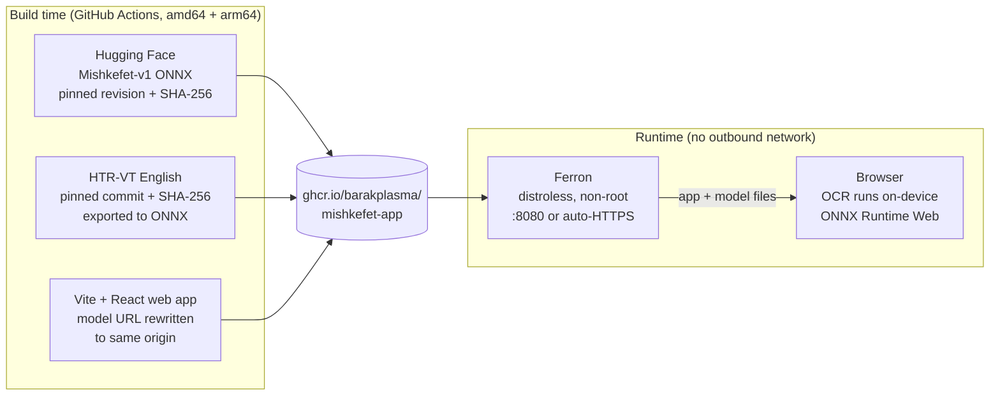

# משקפת · Mishkefet (offline Docker fork)

Hebrew handwriting recognition that runs entirely in your browser, and learns your
handwriting. Nothing is uploaded. This fork packages the web app and its models into
one self-contained Docker image, so you can host it yourself and it never contacts the
internet at runtime.

This is a fork of [itayinbarr/mishkefet-app](https://github.com/itayinbarr/mishkefet-app).
All recognition work, the app, and the Mishkefet-v1 model are the upstream authors'.
This fork adds the Docker packaging and an English handwriting model.

## Quick start

```sh
docker run --rm -p 8080:8080 ghcr.io/barakplasma/mishkefet-app:latest
# open http://localhost:8080
```

- Images for `linux/amd64` and `linux/arm64` (runs on a Raspberry Pi, a Hetzner ARM VPS, or k3s).
- Models are baked in. After you pull the image, no network access is needed.
- Runs as a non-root user on the official distroless [Ferron](https://github.com/ferronweb/ferron) image.
- Public hosting with automatic Let's Encrypt HTTPS: see [`docker/README.md`](docker/README.md).

The browser only allows the camera, the service worker and the model hash check in a
secure context. `http://localhost` counts, `http://192.168.x.x` does not, so put a TLS
ingress or the built-in automatic HTTPS in front of it for other devices.

## How the image is built



Everything is pinned: the Hebrew model by revision and SHA-256, the English model code by
git commit and its weights by SHA-256. The build fails if upstream changes the one line
that points the app at Hugging Face, rather than silently shipping an image that phones home.

## Languages

| Language | Model | Notes |
|---|---|---|
| Hebrew (modern cursive) | [Mishkefet-v1](https://huggingface.co/itayinbar/Mishkefet-v1) | Upstream model, 30M-parameter CNN + ViT CTC recognizer |
| English | HTR-VT (fp16), trained on IAM | Added in this fork, exported by `tools/model-en` |

## Licensing, please read

- Code: MIT.
- The Mishkefet-v1 weights are **CC-BY-NC-SA-4.0**. An image that embeds them is for
  **non-commercial use only**, and the weights layer stays under the same license.
- The English model's code and weights have their own licenses. See `NOTICE`.
- Do not use this image in a paid product or service.

---

*Below: the upstream project description.*

## About Mishkefet

Photograph a line or a whole page (or pick images and PDFs), and Mishkefet reads
it on the device and keeps every scan and its readings. Write a few words on the
screen and it fine-tunes itself to your hand: every 40 words it refits, measures
itself on words it never trained on, and keeps the new version only if it got
better. Any scan can be read with the general model or with your fine-tuned one.

Powered by [Mishkefet-v1](https://huggingface.co/itayinbar/Mishkefet-v1), a
30M-parameter CNN + ViT CTC recognizer for modern Hebrew cursive (best page CER on
the ivrit.ai handwriting leaderboard; training code in
[heb-ocr](https://github.com/itayinbarr/heb-ocr)).

- **Hosted web app** (upstream): https://itayinbarr.github.io/mishkefet-app/

## Layout

| path | what |
|---|---|
| `web/` | Vite + React web app |
| `ios/` | SwiftUI iPhone app (`xcodegen`), with the `MishkefetCore` engine package |
| `spec/` | What both apps implement: written specs, test vectors, golden readings |
| `tools/model/` | Reference pipeline (`reference.py`), ONNX export, LM conversion, fine-tuning reference and simulation, pinned model fetch |
| `tools/model-en/` | English HTR-VT export to the app's format |
| `docker/` | Ferron config and self-hosting docs |

## How it works

A page is binarized, deskewed, cleaned of ruled lines and cut into lines
(`spec/segmenter.md`). Each line is contrast-normalized and scaled to 64 px, read
at three horizontal scales by the fp16 ONNX backbone, and decoded with a CTC prefix
beam search fused with a character 6-gram and a word prior (`spec/decoder.md`).

The CTC head (one 512 to 198 layer) runs outside ONNX, so fine-tuning is a small,
hand-written CTC + Adam loop over cached backbone features (`spec/adapter.md`).
Simulated on ten real writers, one round cuts that writer's character error rate by
about 17%.

## License

Code: MIT. Model, data and fonts: see `NOTICE`. The Mishkefet-v1 weights are
CC-BY-NC-SA-4.0, so this project is and stays free and non-commercial.
